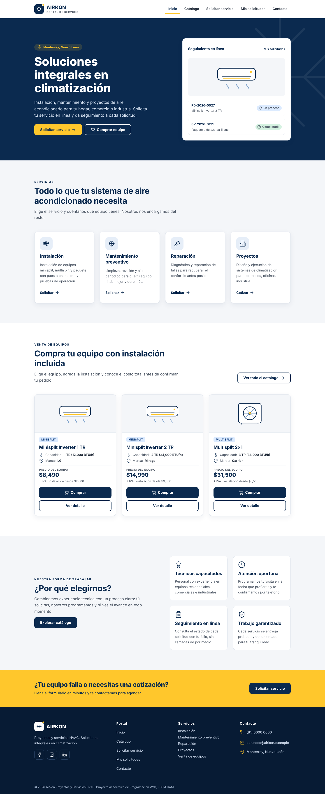
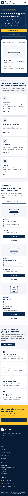
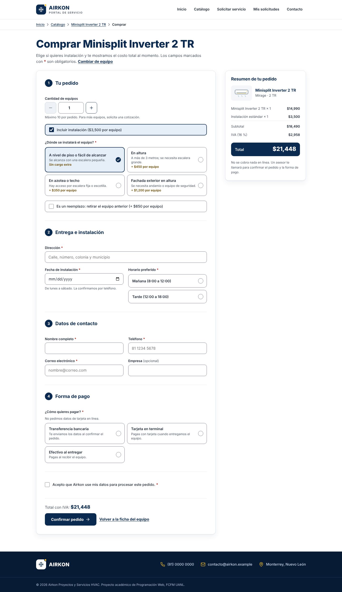
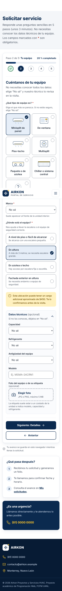

# Portal de Servicio Airkon

Aplicación web interactiva de una empresa de aire acondicionado. El cliente puede:

- **Comprar un equipo** del catálogo, con o sin instalación, y ver el costo total al momento.
- **Solicitar un servicio** (instalación, mantenimiento, reparación o diagnóstico) con un asistente de 5 pasos que no exige conocer los datos técnicos del equipo.
- **Dar seguimiento** a sus servicios y pedidos después de verificar su correo con un enlace de acceso (simulado), para que nadie vea datos ajenos con solo conocer un folio.

Proyecto final de **Programación Web**, FCFM UANL (agosto-diciembre 2026).

- **Autores:** Emiliano Chacón Álvarez, Regina Hernández Rodríguez
- **Sitio publicado:** (Aqui va el link cuando lo publiquemos)
- **Tecnologías:** React 18, Vite 5, React Router 6, CSS Modules, localStorage

> Proyecto académico. Los datos de contacto y el catálogo son de ejemplo.

---

## Capturas

| Escritorio | Móvil |
|---|---|
|  |  |
|  |  |

El bosquejo original (HTML y capturas de las 5 pantallas en 1440 px y 390 px, más la guía de estilos) está en [`docs/bosquejos/`](docs/bosquejos/). Las pantallas que se agregaron después (compra y asistente por pasos) se documentan con capturas del diseño final en [`docs/capturas/`](docs/capturas/).

---

## Estructura

```
src/
├── components/
│   ├── layout/        Layout, Navbar (menú hamburguesa), Footer
│   ├── ui/            Icono, Logo, CampoFormulario, GrupoOpciones, BarraProgreso,
│   │                  Modal, EstadoBadge, FiltroChips, MigasDePan, Paginacion,
│   │                  ResumenErrores, EncabezadoPagina
│   ├── equipos/       TarjetaEquipo, FiltrosEquipos, IlustracionEquipo
│   ├── compras/       FormularioCompra, ResumenCompra
│   └── solicitudes/   AsistenteSolicitud, pasos/ (5 pasos), CampoFoto,
│                      TablaSolicitudes, DetalleRegistro, AccesoSolicitudes
├── pages/             Inicio, Catalogo, DetalleEquipo, Comprar, Solicitar,
│                      Confirmacion, MisSolicitudes, VerificarAcceso, Contacto,
│                      NoEncontrado (404)
├── context/           SesionContext (acceso simulado) y SolicitudesContext
│                      (servicios y pedidos, filtrados por dueño)
├── hooks/             useLocalStorage, useFormulario, useTituloPagina
├── data/              equipos (con precios), servicios (listas), registros de ejemplo
├── utils/             validaciones, precios, registros, formato, seguridad
└── styles/            variables.css, global.css y formulario.module.css (compartido)
```

## Rutas

| Ruta | Página |
|---|---|
| `/` | Inicio |
| `/catalogo` | Catálogo con búsqueda, filtros, orden y paginación |
| `/catalogo/:id` | Detalle de un equipo con precio (ruta dinámica) |
| `/comprar/:id` | Compra del equipo con instalación opcional y resumen de costos |
| `/solicitar` | Asistente de 5 pasos (acepta `?equipo=` y `?servicio=` para llenar datos) |
| `/solicitud-enviada/:folio` | Confirmación de servicio (`SV-…`) o de pedido (`PD-…`) |
| `/mis-solicitudes` | Pide verificar el correo; después muestra solo los servicios y pedidos de ese correo, con filtros, búsqueda y modal |
| `/verificar?token=…` | Destino del enlace de acceso: valida el token y abre la sesión |
| `/contacto` | Formulario de contacto y preguntas frecuentes |
| `*` | Página 404 |

---

## Criterios de la rúbrica que se cumplen

### 1. Diseño
Bosquejo de alta fidelidad de 5 pantallas en escritorio y móvil, con guía de estilos (`docs/bosquejos/`).
- **Azul marino `#0B2A4F`** como color principal: transmite confianza y se asocia con frío y climatización.
- **Amarillo `#FFC72C`** solo como acento para la acción principal, así el ojo va directo a "Solicitar servicio".
- **Montserrat** para títulos (geométrica y técnica) e **Inter** para texto (muy legible en pantallas pequeñas).
- El orden de las secciones sigue el objetivo del sitio: entender qué hace la empresa → elegir servicio o equipo → solicitar → dar seguimiento.

### 2. Usabilidad
| Heurística | Dónde se aplica |
|---|---|
| Visibilidad del estado del sistema | Barra de progreso con porcentaje y "Paso 2 de 5", total del pedido que se actualiza en vivo, menú con la página actual, botón "Enviando...", etiquetas de estado |
| Relación con el mundo real | Preguntas en lenguaje del cliente ("¿Dónde está el equipo?", "¿Qué le pasa?"), tipos de equipo con dibujo, opción "No sé" en todo dato técnico |
| Control y libertad | Botón "Anterior" sin perder datos, pasos completados clicables, "Editar" desde la revisión, "Empezar de nuevo", cerrar modal con Esc, confirmación antes de cancelar |
| Consistencia | Mismos componentes (botón, tarjeta de opción, campo, badge) en compra, asistente y contacto |
| Prevención de errores | Paso de revisión antes de enviar, validación por paso, fecha mínima de mañana y sin domingos, cantidad máxima, aviso de cargo extra por ubicación |
| Reconocer en vez de recordar | Datos del equipo llenados desde el catálogo, resumen de todo lo capturado, borrador recuperado al recargar |
| Flexibilidad | Enter avanza de paso; los datos técnicos y la foto son opcionales para quien sí los conoce |
| Diseño minimalista | Una pregunta principal por paso; datos técnicos dentro de una sección plegable |
| Ayuda a reconocer errores | Mensajes específicos con icono y resumen de errores con enlaces a cada campo |

### 3. Pruebas de Lighthouse y Axe
Resultados en `docs/lighthouse/` y `docs/axe/`.

### 4. Diseño responsivo
- Enfoque **mobile-first**: los estilos base son para 390 px y las media queries `min-width: 768px` y `1024px` adaptan a tableta y escritorio.


### 5. Framework y componentes
React con componentes reutilizables que reciben datos por **props** (`TarjetaEquipo`, `CampoFormulario`, `GrupoOpciones`, `BarraProgreso`, `Modal`...). `GrupoOpciones` y `CampoFormulario` se usan en los tres formularios. Estado local con `useState`, estado global con **Context API**, valores derivados con `useMemo`, referencias con `useRef` (gestión del foco), efectos con `useEffect` y **hooks personalizados** (`useFormulario`, `useLocalStorage`, `useTituloPagina`). Cada paso del asistente es un componente propio.

### 6. Navegación interna
React Router con 9 rutas más la 404, `NavLink` con `aria-current="page"`, ruta dinámica `/catalogo/:id`, parámetros de búsqueda (`?equipo=`), migas de pan y navegación programática con `useNavigate` al enviar el formulario.

### 7. Semántica HTML5
`header`, `nav` (menú, migas de pan y progreso), `main`, `section`, `article`, `aside`, `footer`, `form`, `fieldset`/`legend` (cada grupo lógico), `label`, `table` con `caption`/`thead`/`th scope` (también en el desglose de costos), `dl`/`dt`/`dd`, `ol` en los pasos y migas de pan, `time`, `address`, `details`/`summary` (datos técnicos opcionales y preguntas frecuentes).

### 8. Formularios
Tres formularios con validación propia:
- **Asistente de servicio por pasos**: valida solo el paso actual; los datos técnicos son opcionales; foto con validación de tipo y tamaño; síntomas o descripción obligatorios solo cuando hay falla.
- **Compra de equipo**: cantidad de 1 a 10 con botones − / +, instalación opcional, ubicación, retiro del equipo anterior, forma de pago (sin datos de tarjeta) y total recalculado con IVA.
- **Contacto**.
- Reglas: obligatorios, nombre mínimo de 3 letras, teléfono de 10 dígitos, correo con expresión regular, fecha futura sin domingos, longitudes, aviso de privacidad.
- Controles: texto, correo, teléfono, número, fecha, select, textarea, radios y checkboxes en forma de tarjeta, archivo.
- Errores accesibles: `aria-invalid`, `aria-describedby`, resumen con `role="alert"` que recibe el foco.

#### Accesibilidad del asistente por pasos
- Al cambiar de paso el foco va al encabezado del paso (`h2` con `tabIndex="-1"`), así el lector de pantalla anuncia la nueva pregunta.
- La barra usa `role="progressbar"` con `aria-valuenow` y `aria-valuetext` ("40 % completado, paso 3 de 5"); el paso actual lleva `aria-current="step"` y cada paso dice si está completado, actual o pendiente.
- Si hay errores, el resumen recibe el foco y cada error enlaza a su campo.
- Las tarjetas de opción son `input` radio/checkbox reales: funcionan con flechas y espacio, y muestran foco visible, borde, fondo y palomita (no solo color).
- El total del pedido está en una región `aria-live` para que se anuncie al cambiar opciones.

### 9. Eventos
| Evento | Uso |
|---|---|
| `onSubmit` | Envío de formularios |
| `onChange` | Campos controlados, filtros, búsqueda en vivo, orden, cambio de estado |
| `onBlur` | Valida un campo al salir de él |
| `onInput` | Contador de caracteres de la descripción |
| `onChange` (archivo) | Valida la foto y genera la vista previa con `URL.createObjectURL` |
| `onReset` | Botón "Limpiar formulario" |
| `onClick` | Menú hamburguesa, chips, paginación, modal, Anterior/Editar en el asistente, − / + de cantidad |
| `onKeyDown` | Esc cierra el modal y borra la búsqueda; Tab queda atrapado dentro del modal |
| `onMouseDown` | Clic en el fondo cierra el modal |
| `keydown` (window) | Esc cierra el menú móvil |

---

## Seguridad:

- **Confirmación protegida:** `/solicitud-enviada/:folio` solo muestra datos si el registro se acaba de crear en esa pestaña o si es del cliente verificado. Si no, muestra el mismo aviso exista o no el folio.
- **Inicio:** la tarjeta "Seguimiento en línea" ya no muestra folios sin sesión.
- **Límites:** máximo 5 enlaces por hora y espera de 30 segundos para reenviar.
- El correo se muestra parcialmente oculto (`m•••a@correo.com`).

**Qué es simulación y cómo sería en producción**

| En este proyecto | En producción |
|---|---|
| El "correo" aparece en una bandeja de ejemplo en la misma página | Se envía un correo real (p. ej. con un servicio de correo transaccional) |
| Token y sesión en `sessionStorage` | Token guardado como *hash* en la base de datos; sesión en una cookie `HttpOnly`, `Secure` y `SameSite` que JavaScript no puede leer |
| `SolicitudesContext` filtra los registros por correo | El **servidor** filtra en la consulta (`WHERE correo = correo_de_la_sesión`) y responde 403/404 a folios ajenos; el navegador nunca recibe datos de otros clientes |
| Límite de envíos guardado en la pestaña | Límite por IP y por correo en el servidor |

> Para probar: en Mis solicitudes usa **maria@correo.com** (registros de ejemplo) o el correo que pusiste al hacer una solicitud o un pedido.

---

## Pruebas de accesibilidad y rendimiento

Se usaron **Lighthouse** (Chrome DevTools) y **axe DevTools** en las rutas principales, en móvil y escritorio.

### Resultados finales

### LightHouse
Medido con Lighthouse 13 en Chrome (ventana de incógnito) sobre la versión compilada
(`npm run build` + `npm run preview`). Los reportes completos están en [`docs/lighthouse/`](docs/lighthouse/).

| Página | Dispositivo | Rendimiento | Accesibilidad | Buenas prácticas | SEO | LCP | TBT | CLS |
|---|---|:---:|:---:|:---:|:---:|:---:|:---:|:---:|
| Inicio | Móvil | 97 | 100 | 100 | 100 | 1.9 s | 120 ms | 0 |
| Inicio | Escritorio | 100 | 100 | 100 | 100 | 0.5 s | 50 ms | 0.004 |
| Catálogo | Móvil | 93 | 100 | 100 | 100 | 1.9 s | 270 ms | 0 |
| Catálogo | Escritorio | 100 | 100 | 100 | 100 | 0.4 s | 0 ms | 0.007 |
| Solicitar servicio | Móvil | 96 | 100 | 100 | 100 | 2.0 s | 160 ms | 0 |
| Solicitar servicio | Escritorio | 100 | 100 | 100 | 100 | 0.4 s | 10 ms | 0 |
| Mis solicitudes | Móvil | 98 | 100 | 100 | 100 | 1.9 s | 110 ms | 0.001 |
| Mis solicitudes | Escritorio | 100 | 100 | 100 | 100 | 0.5 s | 0 ms | 0.001 |
| Contacto | Móvil | 97 | 100 | 100 | 100 | 1.9 s | 130 ms | 0 |
| Contacto | Escritorio | 100 | 100 | 100 | 100 | 0.5 s | 30 ms | 0 |

**Cómo leer las métricas:** LCP es cuánto tarda en verse el contenido principal (bueno: menos de 2.5 s),
TBT es cuánto tiempo la página no responde mientras carga (bueno: menos de 200 ms) y CLS es cuánto se mueve el contenido al cargar (bueno: menos de 0.1).

### Axe DevTools

Escaneo con la extensión **axe DevTools** en Chrome, con la configuración **WCAG 2.1 AA**
y **mejores prácticas activadas**, sobre la versión compilada (`npm run preview`).
Como Axe solo revisa lo que está en pantalla, también se escanearon los estados
interactivos (menús, paneles, modales y formularios con errores).

**Resultado: 0 incidencias en todas las páginas** (0 críticas, 0 graves, 0 moderadas, 0 leves).

Durante el desarrollo, Axe sí detectó problemas, que se corrigieron antes de este resultado
(ver la tabla "Problemas encontrados y corregidos"), entre ellos `color-contrast`,
`landmark-complementary-is-top-level`, `heading-order` y `aria-allowed-role`.

### Problemas encontrados en el proceso y corregidos

| Herramienta | Problema | Corrección |
|---|---|---|
| Axe | `color-contrast`: texto claro sobre fondo blanco en las tarjetas oscuras ("¿Es una urgencia?") | Los estilos globales se cargaban después de los CSS Modules y pisaban el fondo azul. Se importan antes que `App` en `main.jsx` |
| Axe | `landmark-complementary-is-top-level`: `<aside>` dentro de otra sección con nombre | La tarjeta de seguimiento del inicio y el llamado del detalle pasaron a `<div>`; el contenedor del catálogo dejó de ser región |
| Axe | `heading-order`: salto de `h1` a `h3` en el catálogo móvil | Se agregó un `h2` "Resultados" visible solo para lectores de pantalla |
| Lighthouse | `robots-txt` inválido (SEO 91) | Se agregó `public/robots.txt` |
| Revisión visual | La leyenda de los fieldsets quedaba encima de la línea divisoria | `float: left` en la leyenda para que quede dentro del contenido |
| Revisión visual | Los botones de la tarjeta de equipo se cortaban en 3 columnas | Se apilaron: "Comprar" arriba y "Ver detalle" abajo |

---

